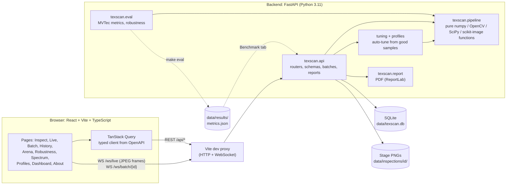
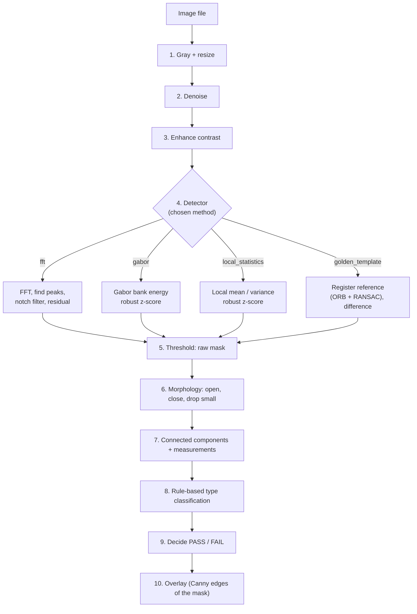

# TexScan

Surface and fabric **defect inspection** with **classical image processing only**: no deep learning, no trained weights.
Drop in a photo of a textile (or tile, leather, wood…), and TexScan says PASS or FAIL, outlines every defect, names its type
(hole, tear line, stain, thread / fibre) and lets you open up every processing step to see how it got there.

It is a college Image Processing project, so the emphasis is on *seeing* the maths: every stage is a small pure function
with its formula in the docstring, and the app has a page for each idea (histograms, FFT, filtering, registration, morphology, compression, bit planes…).
The **About** page in the app maps each lab syllabus topic to the page and source file where it lives.

<!-- Screenshots: save PNGs to docs/screenshots/ (e.g. 1400 px wide, dark theme) and keep these paths, or edit them. -->
| Inspect | Pipeline X-Ray | Spectrum Studio |
|---|---|---|
|  |  |  |
| **Live webcam** | **Method Arena** | **Dashboard** |
|  |  |  |

## Contents
[The problem](#the-problem) · [Architecture](#architecture) · [The pipeline](#the-pipeline) · [Detection methods](#detection-methods) ·
[Benchmark](#benchmark) · [Setup](#setup) · [Demo data](#demo-data) · [MVTec AD download](#mvtec-ad-download) · [The app](#the-app) · [API](#api) ·
[Profiles and the CLI](#profiles-and-the-cli) · [Tests](#tests) · [Limits](#limits)

## The problem
Looking for flaws in cloth, leather or tile by eye is slow and inconsistent. The surface is a *texture*: a repeating or random pattern that is
different in every sample, so "find the thing that is not the pattern" needs more than a fixed threshold on brightness.
TexScan tackles it with four classical ideas, each suited to a different kind of texture:

* a **periodic** weave has a few sharp peaks in its Fourier spectrum; remove them and only the defect is left,
* any texture has **local statistics** (mean, variance) and **orientation / scale energy** (Gabor filters) that a defect disturbs,
* a **known-good reference**, once registered (aligned) to the test image, can simply be subtracted.

Everything after detection is shared: clean the mask with morphology, measure each connected region, classify it with readable rules, decide PASS / FAIL.

## Architecture



* `backend/texscan/pipeline/`: every image-processing step as a **pure function** (array in, array out; no file I/O, no globals, inputs are never modified). Each has a pytest test.
* `backend/texscan/api/`: FastAPI routers, Pydantic schemas, background batches, the `/ws/live` stream. File and database I/O live here, never in the pipeline.
* `backend/texscan/eval/`, `robustness.py`, `tuning.py`, `profiles.py`, `report/`: evaluation, stress tests, threshold tuning, PDF export.
* `frontend/`: React app. The API client is **generated from the backend OpenAPI schema** (`make api-types`), so response types are never written by hand.
* `data/`: the SQLite file, stored stage images, sample images and results (git-ignored except `data/samples/`).

## The pipeline



The Pipeline X-Ray in the app steps through every one of these images with the explanation and formula for the current settings. In short:

| Stage | What it does | Math |
|---|---|---|
| Gray + resize | luma conversion, longest side scaled to `max_side` (default 1024) | $Y = 0.299R + 0.587G + 0.114B$ |
| Denoise | median (impulse noise, keeps edges) or Gaussian (low-pass) over a $k\times k$ window | $out(x)=\operatorname{median}\{in(x+d)\}$ or $out = in * G_\sigma$ |
| Enhance | global histogram equalization or CLAHE (per tile, histogram clipped, tiles interpolated) | $k' = 255\cdot \mathrm{CDF}(k)$ |
| FFT spectrum | Hann window, 2-D FFT, zero frequency centred, log magnitude for display | $F=\mathrm{fftshift}(\mathrm{FFT2}((f-\bar f)\,w)),\ L=\log(1+\lvert F\rvert)$ |
| Peaks | local maxima of the spectrum above $\mu + k\sigma$, outside a DC disk | strong narrow peaks = periodic texture |
| Notch filter | multiply out Gaussian notches at each peak and its mirror, transform back | $H=\prod_k\bigl(1-e^{-d_k^2/2\sigma^2}\bigr),\ g=\mathrm{IFFT2}(F\cdot H)$ |
| Residual to mask | smooth the absolute residual, threshold with Otsu (or adaptive), never below a floor | $m=G_\sigma*\lvert r-\operatorname{median}(r)\rvert,\ mask=m>T$ |
| Gabor | quadrature Gabor pairs at several orientations and wavelengths; per-channel robust outlier score | $g=e^{-(x'^2+0.25y'^2)/2\sigma^2}\cos(2\pi x'/\lambda+\psi)$ |
| Local statistics | mean and variance in a sliding window via two box filters | $\mu=\mathrm{box}_w(I),\ \sigma^2=\mathrm{box}_w(I^2)-\mu^2$ |
| Robust z-score | outlier-resistant standardisation used by Gabor and local statistics | $z=\dfrac{x-\operatorname{median}}{1.4826\cdot\mathrm{MAD}}$, flag $\lvert z\rvert>k$ |
| Template alignment | ORB keypoints, Hamming matching, RANSAC homography $p_{test}\sim Hp_{ref}$, warp the reference | difference $D=\lvert (T-\bar T)-(R-\bar R)\rvert$ |
| Morphology | opening (erode, dilate) removes specks; closing (dilate, erode) fills gaps; small components dropped | elliptical structuring element |
| Defect measures | 8-connected components: area, perimeter, bounding box, aspect ratio, solidity, orientation, contrast to the surrounding ring | $\theta=\tfrac12\operatorname{atan2}(2C_{xy},C_{xx}-C_{yy})$ |
| Classification | hand-written rules score each type; best score above a minimum wins, with a 0 to 1 confidence | hole, tear line, stain, thread / fibre, unknown |
| Decision | FAIL when there are more defects than `max_defects` or more defective area than `max_area_percent` | defaults: any defect fails |
| Overlay | Canny edges of the final mask painted on the original | gradient + hysteresis |
| Trim + centre (optional, live camera) | crop black letterbox / pillarbox bars, then keep the central part of the picture | a column or row is picture when more than 2 % of its pixels exceed a dark level |

Beyond detection, the app also offers a **Bit-plane viewer** ($P_k=((I\gg k)\ \&\ 1)\cdot255$), frequency-domain **low-pass / high-pass / sharpen** presets
(ideal, Butterworth or Gaussian), a **JPEG compression** experiment (size, ratio, PSNR, SSIM) and noise / blur / brightness stress tests.

## Detection methods
Select with `PipelineConfig.method` (or `--method` in the CLI):

| Method | Best for | Idea |
|---|---|---|
| `fft` | periodic textures (woven cloth, grids) | remove the spectral peaks of the pattern; what is left is the defect |
| `gabor` | stochastic or mixed textures | energy of oriented band-pass filters; defects are outliers |
| `local_statistics` | quick, any texture | sliding-window mean and variance outliers |
| `golden_template` | a fixed product photographed the same way | align a known-good reference and subtract it (needs a reference image) |

All four share the preprocessing, morphology, measurement, classification and overlay stages.

## Benchmark
`make eval` runs every method on five MVTec AD texture categories (carpet, grid, leather, tile, wood) and writes `data/results/metrics.json` and `metrics.md`.
Image-level metrics treat *defective* as positive; IoU and Dice are pixel-level against the ground-truth masks, averaged over defective images.
All methods run with default, **untuned** settings and the golden-template reference is the first `train/good` image of each category.

### Real MVTec AD results
> **Not run yet.** MVTec AD is not bundled (about 5 GB, licence CC BY-NC-SA 4.0). After [downloading it](#mvtec-ad-download), run `make eval` and paste `data/results/metrics.md` here.

| Method / category | Accuracy | Precision | Recall | F1 | IoU | Dice | s/img |
|---|---|---|---|---|---|---|---|
| _carpet, grid, leather, tile, wood × 4 methods_ | _pending_ | | | | | | |

### Synthetic smoke test (not a benchmark)
`make eval-demo` ran the same harness on 16 generated images per category (sinusoid weave, plaid, noise texture) with planted defects. It shows the harness works;
the textures are far easier than real photographs, so **do not read these numbers as real-world performance**. Poor results are kept as measured.

| Method (mean over 3 synthetic categories) | Accuracy | Precision | Recall | F1 | IoU | Dice | s/img |
|---|---|---|---|---|---|---|---|
| fft | 0.875 | 0.875 | 1.000 | 0.923 | 0.557 | 0.614 | 0.39 |
| gabor | 1.000 | 1.000 | 1.000 | 1.000 | 0.212 | 0.345 | 0.46 |
| golden_template | 0.875 | 0.875 | 1.000 | 0.923 | 0.550 | 0.624 | 0.50 |
| local_statistics | 0.771 | 1.000 | 0.633 | 0.769 | 0.389 | 0.458 | 0.12 |

What the toy run does show: `fft` localises defects well (high IoU) on periodic textures but fails on the non-periodic noise texture (accuracy 0.625, IoU 0.02);
`gabor` finds every defective image but its masks overlap the true defect poorly (low IoU); `local_statistics` is the fastest and misses some defects.

## Setup
Requirements: **Python 3.11**, **Node.js 20+** and npm. `make` is optional (on Windows use Git Bash / WSL, `choco install make`, or the PowerShell script below).

```bash
git clone <this repo> && cd TexScan
make setup        # backend venv + pip install -e backend[dev], then npm install in frontend/
make dev          # backend on :8000 and frontend on :5173, one terminal
```

Open <http://localhost:5173>. API docs are at <http://localhost:8000/docs>.

Without make (Windows PowerShell):
```powershell
py -3.11 -m venv backend\.venv
backend\.venv\Scripts\python -m pip install -e "backend[dev]"
cd frontend; npm install; cd ..
.\dev.ps1            # starts both; Ctrl+C stops both
```

| Command | What it does |
|---|---|
| `make dev` / `.\dev.ps1` | backend + frontend |
| `make dev-lan` / `.\dev.ps1 -Lan` | same, frontend over HTTPS on your network (for a phone camera, see [Live](#live)) |
| `make test` | backend pytest suite (frontend: `cd frontend && npm test`) |
| `make seed` | load demo data, see [Demo data](#demo-data) |
| `make eval` / `make eval-demo` | benchmark on MVTec AD / on a generated toy set |
| `make api-types` | re-export the OpenAPI schema and regenerate the typed frontend client (run after changing an endpoint or schema) |

Environment variables: `TEXSCAN_DB` (SQLite file, default `data/texscan.db`), `TEXSCAN_DATA_DIR` (stage images, default `data/inspections`),
`TEXSCAN_CORS_ORIGINS`, `MVTEC_PATH` (dataset folder), `VITE_API_TARGET` (point the dev server at another backend, e.g. `http://127.0.0.1:9000`).

## Demo data
An empty dashboard makes a poor demo. This loads **20 synthetic inspections** (weave, plaid, cloth and leather textures, with and without planted holes, scratches, stains and tears),
spreads their timestamps over the last two weeks, tunes a profile called "Demo weave" from six clean weaves, and groups the last eight images into one batch so the batch PDF report can be shown too.

```bash
make seed                # first time
make seed FORCE=1        # replace earlier demo data (only rows named demo-*.png and the "Demo weave" profile)
# without make:  backend/.venv/Scripts/python backend/scripts/seed_demo.py [--force]
```

Every inspection is a real pipeline run, so the outcomes are whatever the methods decide, mistakes included. It writes to `data/texscan.db`; set `TEXSCAN_DB` first to seed a different file.

## MVTec AD download
1. Download **MVTec AD** from <https://www.mvtec.com/company/research/datasets/mvtec-ad> (about 5 GB; you only need the five texture categories; free for non-commercial use, CC BY-NC-SA 4.0).
2. Extract it so you have a folder containing `carpet/`, `grid/`, `leather/`, `tile/`, `wood/`. Each has `train/good/`, `test/<defect>/` and `ground_truth/<defect>/`.
3. Point `MVTEC_PATH` at that folder and evaluate:
   ```powershell
   $env:MVTEC_PATH = "D:\datasets\mvtec_ad"     # PowerShell
   ```
   ```bash
   export MVTEC_PATH=/data/mvtec_ad              # bash
   make eval
   ```
   A full run is slow (hundreds of images × 4 methods at 1024 px). For a quick look, from `backend/`: `python -m texscan.eval --limit 10 --max-side 512`.
   Other flags: `--methods`, `--categories`, `--workers`, `--out`.
4. Results land in `data/results/`. The Method Arena also lists the MVTec samples (with ground-truth masks) once `MVTEC_PATH` is set, and its Benchmark tab draws the table as a heatmap.

## The app
All pages are registered once in `frontend/src/app/nav.ts`; the sidebar, the command palette and the router read from it. Dark theme by default (light toggle in the top bar).

**Keyboard**: `Ctrl/Cmd+K` command palette, `Ctrl/Cmd+B` sidebar, `U` upload (Inspect), `X` pipeline X-Ray (Inspect), `Ctrl/Cmd+V` paste an image, `←` `→` Space Esc in the X-Ray.
Letter shortcuts are ignored while you type or a menu / dialog is open.

### Inspect
`/inspect`: drop, browse or paste an image, or click a sample (synthetic textures with planted defects from `backend/scripts/make_samples.py`).
* Left panel: method, profile, and an *Advanced* section with sliders (denoise kernel, threshold, minimum area, cleanup kernel, notch radius, window) and the **Bit-plane viewer** (all eight planes of the grayscale image, click one to enlarge). A change re-runs the inspection after a 350 ms pause; re-runs of the same image replace each other in History.
* Result: animated PASS / FAIL, a zoomable viewer (scroll, drag, double-click to fit) with overlay modes Boxes / Mask / Edges / Heatmap, a before / after wipe, the defect table, histograms before and after enhancement and a timing chart.
* **Pipeline X-Ray** (`X`): step through every stage image with a plain-English explanation and formula.
* **Download report**: a two-page PDF (see [PDF reports](#pdf-reports)).

### Spectrum Studio
`/spectrum`: an interactive FFT editor. Detected peaks are circled and can be toggled; paint your own notch with a brush (symmetric by default, as a real image requires);
apply low-pass / high-pass / sharpen presets (ideal, Butterworth, Gaussian); every change calls `/spectrum/apply` and updates the residual, mask and overlay live.

### Live
`/live` inspects a webcam stream. The browser grabs frames with `getUserMedia`, downsizes them to JPEG (240 / 320 / 480 px) and sends them over `/ws/live`;
the server keeps only the newest frame and answers at most 5 times a second (about 4 to 5 fps in practice). Defect boxes are drawn on a canvas over the video next to a large PASS / FAIL indicator and fps / latency readouts.
Pause freezes the video and stops sending; **Capture** saves the current frame at full camera resolution as a normal inspection. Permission denied, no camera, camera busy, an insecure page and a dropped connection each show their own message.
Without a profile it uses the chosen method (Gabor by default) at a 320 px working size; `golden_template` is not available live.

**Getting reliable results on a real camera.** The default thresholds were tuned on synthetic textures, so on real cloth an uncalibrated stream often calls good cloth defective (lighting gradients, folds, the edge of the cloth). Three things fix that:
1. **Black bars are skipped.** A phone relayed as a webcam usually arrives as a portrait picture inside a landscape frame with black bars; the bars were being judged as one big defect. The server trims them (`trim_borders` in `backend/texscan/pipeline/borders.py`).
2. **Inspect area: Middle 60%** (default) ignores the outer part of the picture, where the edge of the cloth would be flagged. A dashed box on the video shows what is inspected; the rest is dimmed.
3. **Calibrate.** Fill the dashed box with good, defect-free cloth and press **Calibrate**: 12 frames are taken over about 4 seconds (move the cloth slightly), the server tunes a threshold and minimum area on them, and the new profile becomes active. Judge against that from then on. Calibrate again if the lighting or the cloth changes.

Capture uses the same settings, so its verdict matches what was on screen.

**Phone camera on the same Wi-Fi.** Browsers allow the camera only on `https://` or `localhost`, so plain `http://<laptop-ip>:5173` will not work.
1. Put the phone on the same Wi-Fi as the computer (not a guest network; those often isolate devices).
2. Run `make dev-lan` (or `.\dev.ps1 -Lan`). Vite serves HTTPS with a self-signed certificate.
3. Open the `Network:` address Vite prints (for example `https://192.168.1.23:5173/`) on the phone and go to **Live**.
4. Accept the one-time certificate warning (iPhone Safari: Show Details, then visit this website; Android Chrome: Advanced, then Proceed).
5. Tap **Start camera**. The rear camera is used by default.

If the phone cannot connect, allow Node.js through Windows Defender Firewall for private networks. The backend stays on `localhost:8000`; the Vite proxy forwards API and WebSocket traffic.

### Batch, History, Dashboard, Profiles
* **Batch**: drop a folder or many images; each is a tile that flips to its overlay with PASS / FAIL as the server finishes it (WebSocket progress with a polling fallback). More than 100 images run as consecutive batches. Summary, failed images, **Export CSV** (file names neutralised against spreadsheet formulas) and **Download report**.
* **History**: search and filter by decision, method, profile, date range or batch; a row opens every stage image, defects, timings, settings, the X-Ray, a PDF report and delete. `/history?id=12` deep-links.
* **Dashboard**: total, pass rate, average processing time, most common defect, inspections per day, defect-type donut, pass rate by profile.
* **Profiles**: upload 5 to 20 good samples to learn a threshold and minimum area for a material; the detail view shows the leave-one-out pass rate and a histogram of the good samples' scores.

### Method Arena and Robustness Lab
* **Method Arena**: all four methods on one image side by side with overlay, mask or error map (green found, red false alarm, amber missed), IoU, Dice, precision, recall and runtime. Pixel F1 is mathematically Dice, so they are shown as one metric. The **Benchmark** tab is the method × category heatmap of `make eval`.
* **Robustness Lab**: degrade an image step by step (noise, blur, brightness, JPEG quality) and chart defect area with a verdict marker per level. The JPEG sweep is the compression experiment: file size, ratio, PSNR and SSIM.

### About
`/about` maps each lab syllabus topic (read image, noise, histogram, edges, rotation / translation by registration, bit planes, enhancement, FFT, spatial and frequency smoothing / sharpening, compression, morphology, restoration)
to the page where you can see it and the source file that implements it, with honest notes where coverage is partial.

### PDF reports
**Download report** buttons on Inspect, the History detail panel and the Batch results produce clean A4 PDFs (ReportLab, `backend/texscan/report/`):
* *Inspection report* (2 pages): date, profile, method, verdict with key numbers, original and overlay, defect table with types, a strip of every pipeline stage, the exact settings used and a timing chart.
* *Batch report*: summary tiles, defect-type breakdown, a table of every image and the overlays of the failed ones (first 60).

## API
`make dev` serves it on <http://localhost:8000> (interactive docs at `/docs`). The Vite dev server proxies `/api/*`, WebSockets included. Stage image URLs look like `/files/<id>/overlay.png`.

| Endpoint | Purpose |
|---|---|
| `POST /inspect` | image (+ `reference`, `profile_id`, `method`, `config` JSON overrides) → decision, typed defects, metrics, timings, stage image URLs. Stored in SQLite; images in `data/inspections/<id>/` |
| `POST /inspect/batch` | many images → `batch_id`; progress on `WS /ws/batch/{id}`; `GET /inspect/batch/{id}` for status |
| `GET /inspections`, `GET/DELETE /inspections/{id}` | history; filters `decision`, `profile_id`, `method`, `q`, `batch_id`, `date_from`, `date_to`, `limit`, `offset` |
| `GET /inspections/{id}/bit-planes` | the eight bit planes of the stored grayscale image (PNG data URIs, MSB first) |
| `GET /inspections/{id}/report.pdf`, `GET /batches/{batch_id}/report.pdf` | PDF reports |
| `POST /profiles/autotune`, `GET /profiles`, `GET/DELETE /profiles/{id}` | tune from 5 to 20 good images; history survives profile deletion |
| `POST /spectrum`, `POST /spectrum/apply` | spectrum with peaks; notch mask and radial presets → residual, mask, defects |
| `POST /arena` | several methods on one image (optional ground-truth mask → IoU, Dice, precision, recall) |
| `POST /robustness` | noise / blur / brightness / JPEG sweeps → decision, defect area, PSNR, SSIM per level |
| `GET /datasets/mvtec…`, `GET /benchmark?source=mvtec\|synthetic` | browse MVTec (needs `MVTEC_PATH`) and read the evaluation table |
| `GET /stats` | totals, pass rate, timing, defects by type, pass rate by profile, inspections per day |
| `WS /ws/live` | binary JPEG frames in; decision + overlay out; newest frame only, about 5 fps max |

Config precedence: defaults < profile < `config` overrides < `method`. Errors are `{"detail": "<message>"}`; bad images give 422, unknown ids 404, oversized files 413.
Batch progress is held in memory (a restart forgets running batches; stored inspections stay).

## Profiles and the CLI
Each defect gets a rule-based type and a confidence (`backend/texscan/pipeline/classify.py`). Tune thresholds to a material from 5 to 20 known-good images and store them as a named profile:
```bash
python -m texscan.cli tune "Denim" good1.png good2.png ... --method fft     # fft | gabor | local_statistics
python -m texscan.cli profiles
python -m texscan.cli inspect fabric.png --profile "Denim"
```
(run from `backend/`).

## Tests
```bash
make test                       # backend: pipeline steps, detectors, API, reports, profiles, eval, seed script
cd frontend && npm test         # frontend: pure UI logic (viewport math, config mapping, stage text, hotkeys, error handling…)
cd frontend && npx tsc -b       # type check (strict, no any)
```

## Project rules
1. Every image-processing step is a pure function in `backend/texscan/pipeline/` with a short docstring explaining the maths.
2. **No deep learning libraries, ever.**
3. Every pipeline function has a pytest test.
4. Type hints everywhere, no `any`; keep functions small.

Frontend conventions: the API client is generated from the OpenAPI schema (never hand-written types); pages are registered once in `frontend/src/app/nav.ts`; colours come from the theme tokens in `src/index.css`; every data view has a loading and an empty state; pure UI logic lives in plain `.ts` files with Vitest tests.

## Limits
* Classical methods have well-known limits: the FFT method needs a periodic texture; `local_statistics` and `gabor` flag any strongly non-uniform region, so real photographs with uneven lighting need a tuned profile; `golden_template` needs a reference taken under similar conditions.
* The sample images and the demo data are **synthetic**. Real-world performance has to be measured on MVTec AD (see above) or your own photographs.
* There is no spatial-domain sharpening filter and no deblurring; restoration means notch-filtering a known periodic pattern.
* Live inspection is about 5 fps at most and depends on the machine running the backend. Phone use needs HTTPS (`make dev-lan`).
